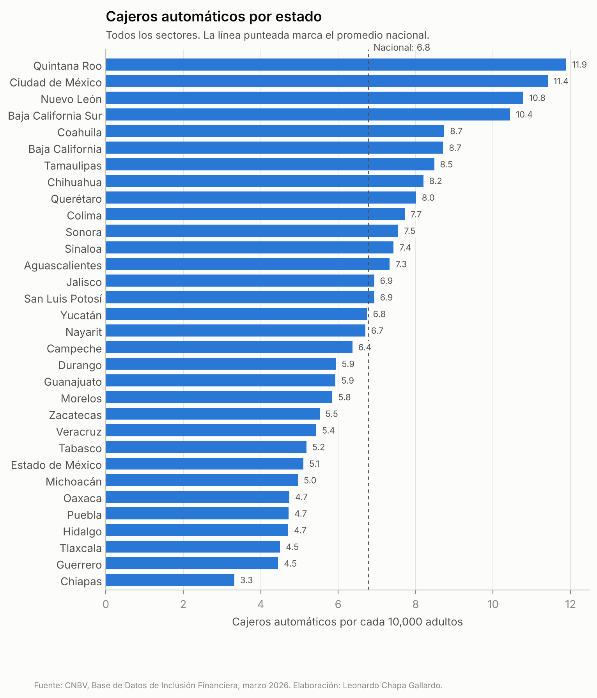
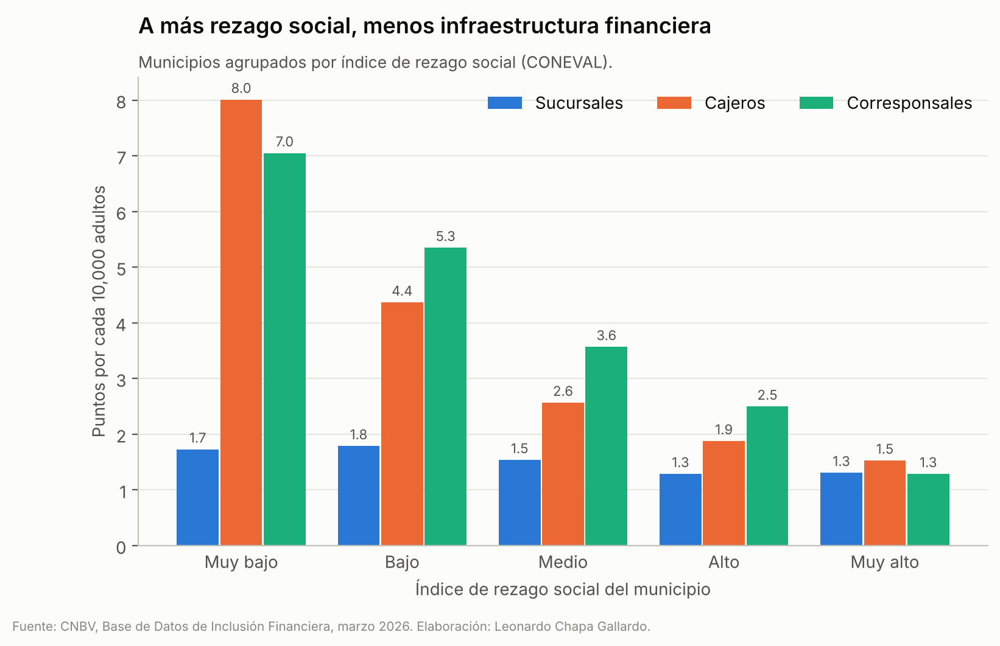
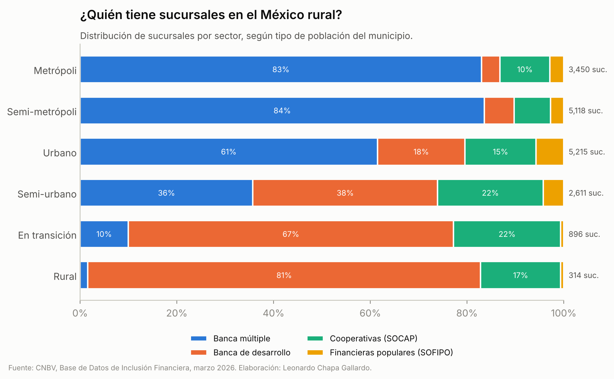
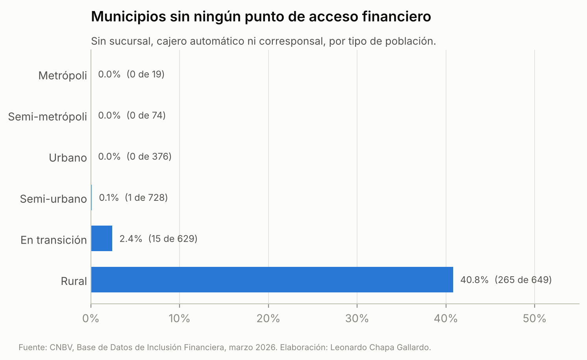

# Inclusión financiera en México: limpieza y análisis de la base de la CNBV

**Leonardo Chapa Gallardo** · Estudiante de Actuaría, Facultad de Ciencias, UNAM

Proyecto personal de portafolio, hecho con datos públicos: tomar un Excel público de la Comisión Nacional Bancaria y de Valores, pensado para leerse a mano, y convertirlo en una base limpia, validada y lista para analizar. Después, usarla para responder una pregunta concreta: **¿qué tan desigual es el acceso a la infraestructura financiera entre municipios?**

## El problema con el archivo original

La [Base de Datos de Inclusión Financiera](https://www.gob.mx/cnbv/acciones-y-programas/bases-de-datos-de-inclusion-financiera) (corte a marzo de 2026) trae 19 hojas. En las dos que usé, *Infraestructura* y *Captación* a nivel municipal:

| Problema | Cómo lo resolví |
|---|---|
| Encabezado de 4 filas con celdas combinadas | Relleno hacia la derecha y unión en nombres `sector__grupo__variable` |
| Nombres con saltos de línea y la unidad pegada (`"Sucursales\nNúmero"`) | Normalización a *snake_case* sin acentos ni unidades |
| 8 filas de portada y una columna vacía | Eliminadas |
| Registro artificial `99999 No identificado` con población cero | Se conserva en totales y se excluye de tasas |
| 3 municipios nuevos sin dato de población (Villa de Pozos, Eldorado, Juan José Ríos) | Marcados con bandera; habrían provocado divisiones entre cero |
| Dos hojas separadas con la misma información general | Unión 1 a 1 por clave municipal, comprobando que coinciden |

## Cómo sé que la limpieza está bien

El código **se detiene** si alguna de estas pruebas falla:

- Las 74 columnas numéricas suman exactamente lo mismo que la fila de totales de control del propio archivo.
- En 19 columnas agregadas, el total es la suma exacta de sus sectores, **municipio por municipio**.
- La clave de municipio es única y la clave de estado coincide con sus primeros dígitos.
- Población adulta = mujeres + hombres en todos los municipios.
- No hay valores negativos ni conteos con decimales.

## Hallazgos

Indicadores por cada 10,000 adultos. Las tasas de cada grupo suman numeradores y denominadores antes de dividir, para no darle el mismo peso a un municipio de 500 adultos que a uno de un millón.

1. **281 municipios no tienen ningún punto de acceso**: ni sucursal, ni cajero, ni corresponsal. Ahí viven unos **418 mil adultos**. Oaxaca concentra 235 de ellos.
2. **El rezago social marca la diferencia.** Los municipios con rezago *muy bajo* tienen 8.0 cajeros por cada 10,000 adultos; los de rezago *muy alto*, 1.5, cinco veces menos. El 21% de los municipios con rezago muy alto no tiene ningún punto de acceso, frente a 1.5% de los de rezago muy bajo.
3. **En el México rural, la banca comercial casi no está.** En municipios rurales, el 81% de las sucursales son de la banca de desarrollo y el 17% de cooperativas. La banca múltiple tiene 5 de 314.
4. **Por estado**, el promedio nacional es de 6.8 cajeros por cada 10,000 adultos. Quintana Roo tiene 11.9 y Chiapas 3.3.

**Advertencia de interpretación:** las cuentas de captación se asignan al municipio donde se registran, no siempre al de residencia. Por eso la Ciudad de México sale con 6.4 cuentas por adulto, frente a una mediana estatal de 1.8. Para comparar territorios usé la infraestructura, que sí está ubicada físicamente.






## Contenido

```
limpieza_bdif_cnbv.ipynb        Notebook con todo el proceso, ejecutado y comentado
src/limpieza.py                 Lectura, aplanado de encabezados, tipado y validaciones
src/analisis.py                 Banderas, indicadores y gráficas
src/exportar.py                 Excel final con diccionario y bitácora
salida/BDIF_202603_limpia.xlsx  Base limpia + resúmenes + diccionario + bitácora
salida/..._municipal_limpia.csv La tabla municipal en CSV (UTF-8)
graficas/                       Las 4 gráficas en PNG
```

El Excel limpio trae 7 hojas: notas, la tabla municipal (2,479 registros × 93 columnas), resúmenes por estado, por rezago social y por tipo de población, un **diccionario de datos** con la descripción de cada columna y la **bitácora de validación**.

## Cómo reproducirlo

1. Descarga la base de marzo de 2026 desde la página de la CNBV y guárdala como `datos_crudos/BDIF_202603.xlsx`.
2. `pip install -r requirements.txt`
3. `python construir_notebook.py`

Herramientas: Python, pandas, openpyxl y matplotlib.
